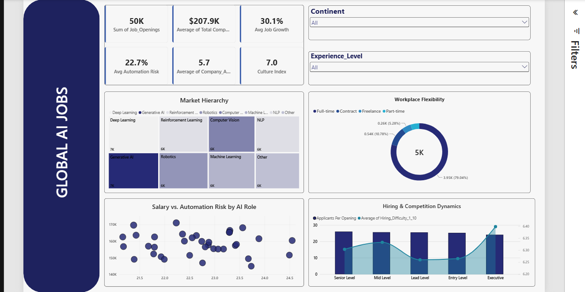
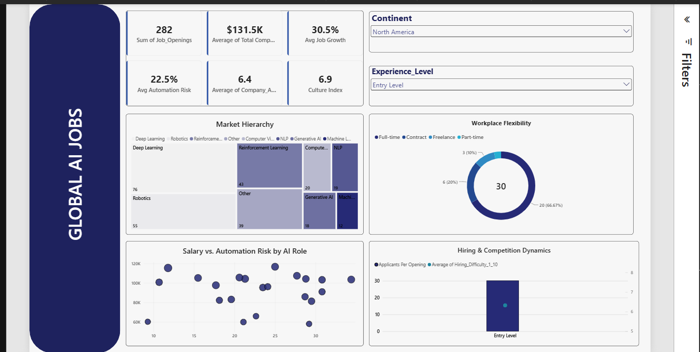

# 📊 Global AI Jobs 2026 Executive Dashboard

An interactive, executive-level Power BI dashboard designed to analyze global AI employment trends, compensation structures, hiring bottlenecks, and automation risk across 5,000+ job postings.

---

## 📌 Executive Dashboard Overview



### Key Metrics Tracked:
* **Total Openings:** Aggregated global candidate demand across specializations.
* **Average Compensation:** Global average total compensation (~$207.9K).
* **Growth & Automation Risk:** Percentage measures evaluating market expansion against role susceptibility to automation.
* **Hiring Dynamics:** Comparison of candidate competition (Applicants per Opening) against hiring difficulty.

---

## 🔍 Feature Spotlight: Regional & Seniority Filtering



By filtering specifically for **Entry-Level roles in North America**, the dashboard delivers localized benchmarks:
* **Entry-Level Compensation:** Averages **$131.5K** with a **30.5%** growth rate.
* **Top Specializations:** Hiring demand is heavily concentrated in **Deep Learning (76 roles)** and **Robotics (55 roles)**.
* **Workplace Flexibility:** **66.7%** Full-Time, **20%** Freelance, and **10%** Contract positions.
* **Competition Index:** High applicant volume (~30 applicants/opening) highlights a competitive early-career talent pool.

---

## 🛠️ Technical Implementation & DAX

### Data Modeling & Design Principles
* **UI/UX Design:** Dark-themed Cobalt Blue (`#3257A8`) UI styled with an executive F-pattern visual hierarchy for quick executive scanning.
* **Data Aggregation:** Fixed scatter plot axis scales to ensure measures evaluated averages ($207K) rather than sums ($25M).

### Key DAX Measures

```dax
// Automation Risk Percentage
Avg Automation Risk = 
DIVIDE(
    AVERAGE(Jobs[Automation_Risk_%]), 
    100, 
    0
)

// Applicants Per Opening Ratio
Applicants Per Opening = 
DIVIDE(
    SUM(Jobs[Total_Applicants]), 
    SUM(Jobs[Job_Openings]), 
    0
)

// Average Total Compensation
Avg Compensation = 
AVERAGE(Jobs[Total_Compensation])
